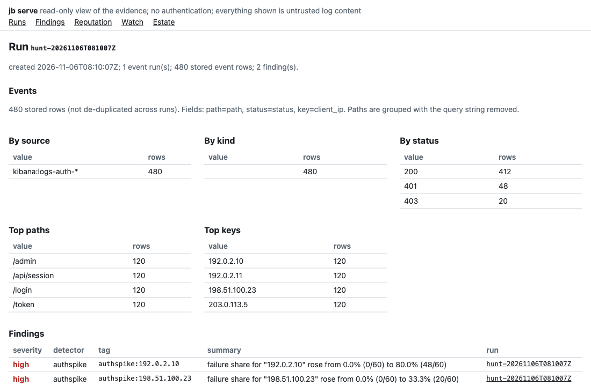
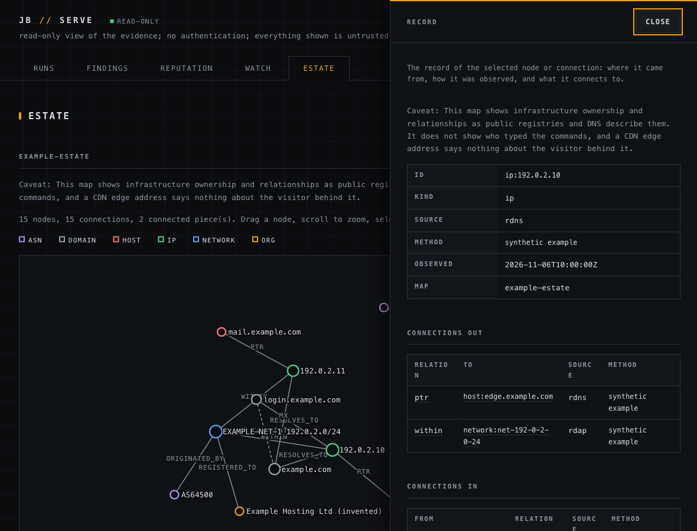

# json-bourne (`jb`)

[](https://pkg.go.dev/github.com/iksnerd/json-bourne) [](LICENSE)

`jb` is an incident-response tool for when you are under attack. It fetches logs for a time window from your own log store, keeps them as evidence in a local DuckDB file, and runs detectors that compare that window with the one before it.

Apache-2.0. Go, DuckDB, cobra.





*`jb serve`, the read-only dashboard, after one hunt over synthetic events (documentation-range addresses, a local stand-in for Kibana, an invented estate). Second image: the interactive estate graph with the selected node's record and its connections in the sheet.*

## Why

During an incident the failure mode that does the most damage is a wrong clean answer: a query that silently returned nothing, a detector that parsed zero records, a count with no baseline. Each looks like "nothing is happening".

`jb` is built so that cannot happen quietly:

- A source or detector that finds zero records returns `core.ErrNoRecords`, and `jb hunt` reports that component as not finished.
- Two logs in one config do not mix: a detector can be limited to named sources (`sources:`), and a filtered source that is alive but quiet can be declared a clean answer for the detectors that read it (`empty_is_quiet`), without making a dead or unreadable source look quiet. See [docs/CONFIG.md](docs/CONFIG.md#detectors).
- If any source or detector did not finish, `jb hunt` prints `INCOMPLETE`, says which one, and exits 1. A hunt is only reported clean when every component completed.
- Detectors judge a window against the preceding window of the same length. A raw count is never a finding.
- Every number in a finding was counted from the events read, and the finding carries both windows' numbers so a reader can check them.
- The evidence database is opened read-only by the storage engine for inspection (`jb db status`), not by a string check on SQL.

## Quick start

You need Go 1.25 or later (`go.mod`) and a C compiler, because the DuckDB driver uses cgo.

```sh
# from the repository root
export GOFLAGS=-mod=mod GOPROXY=off   # only if you build offline and the modules are cached
go build -o bin/jb ./cmd/jb

cp examples/jb.example.yaml jb.yaml   # edit url and index; never put a key in this file
export JB_KIBANA_API_KEY=...          # the variable named by api_key_env
bin/jb hunt --config jb.yaml --window 60m
```

`hunt` reads the last 60 minutes and the 60 minutes before them, saves both as evidence, runs every configured detector and prints a table. `--output json` prints the same result as JSON. Progress goes to stderr, results to stdout.

If the source cannot be reached, the answer is explicit. With the unedited example config (the host does not exist) the run ends like this:

```
SOURCE              STATUS       EVENTS    NOTE
kibana:logs-auth-*  unavailable  0         ... dial tcp: lookup kibana.example.com: no such host

DETECTOR            STATUS       FINDINGS  NOTE
authspike           no_records   0         authspike: no records: current window had 0 events, ...

INCOMPLETE: 2 component(s) did not finish; this is not a clean result.
jb: hunt incomplete, no clean result: 2 component(s) did not finish: [...]
```

To see a hunt that finds something without a Kibana, run the end-to-end test, which serves synthetic events from a local test server:

```sh
go test -count=1 ./cmd/jb -run TestHuntEndToEnd -v
```

### Use as a library

```sh
go get github.com/iksnerd/json-bourne
```

```go
cfg, err := jb.LoadConfig("jb.yaml")
if err != nil {
	return err
}
res, err := jb.Hunt(ctx, cfg, jb.HuntOptions{Window: time.Hour})
if err != nil {
	return err
}
if !res.Complete() {
	return fmt.Errorf("not a clean result: %v", res.Failed())
}
for _, f := range res.Findings {
	fmt.Println(f.Tag)
}
```

`Hunt` does what `jb hunt` does, with the same rules: a nil error means the hunt ran, not that it is clean. Check `Result.Complete()` before reporting that nothing was found.

To write a mapper plugin, import `github.com/iksnerd/json-bourne/sdk` (standard library only, none of the host code) and see [docs/PLUGINS.md](docs/PLUGINS.md). Not public yet: the host side of plugins and a protocol conformance corpus.

The API is v0 and may change between minor versions. Every command has a function, and the command prints the function's result:

| Command | Function |
|---|---|
| `jb hunt` | `Hunt`, `HuntCase` (with `HuntOptions.Search` for `--search`) |
| `jb activity` | `Activity` |
| `jb watch`, `jb watch status` | `Watch`, `WatchStatus` |
| `jb case check`, `jb case show` | `CaseCheck`, `CaseShow` |
| `jb doctor` | `Doctor` (read-only; sends nothing unless `Online` is set) |
| `jb actor status` | `ActorStatus` |
| `jb db status`, `jb db usage` | `DBStatus`, `DBUsage` |
| `jb db reputation` | `Reputation` (read-only; a result cut at the row cap has `Truncated` set and `Complete()` false) |
| `jb db prune`, `compact`, `rename-source` | `DBPrune`, `DBCompact`, `DBRenameSource` (a dry run unless `Apply` is set) |
| `jb intel` | `Intel` |
| `jb estate ...` | `EstateIP`, `EstateASN`, `EstateDNS`, `EstateCT`, `EstateRefresh`, `EstateDiff`, `EstatePromote` |
| `jb serve` | `DashboardHandler`, `Serve` (keeps the read-only, loopback and CSP rules of RFC 0003; read the doc comment before mounting the handler) |

Operations (RFC 0010): `jb.Operations()` lists the definition of each of the 21 operations (everything but `watch` and `serve`, which run until stopped), derived from its option struct's `jb:` tags, and `jb.Call(ctx, name, arguments, env)` checks a JSON-shaped arguments map against that definition and runs the typed function. A bad argument is a `UsageError` that lists every problem. A window, a time and a duration are strings in the arguments (`"window": "2h"`), read by the same code as the flags. `hunt` and `activity` take `store` (default true; the flag `--no-store` is its false form), and an MCP tool runs them with `store` fixed to false: `jb.CallTool` checks a tool call against the tool's schema and adds the fixed values. `jb operations` prints the definitions as JSON (`docs/operations.json` is the committed copy) and `jb operations --tool` prints the entries an MCP `tools/list` result carries. Thirteen commands (`case show`, `case check`, `actor status`, `doctor`, `intel`, `watch status`, `estate promote` and the six `db` commands) register their flags from their operation, so their flags, defaults and help text cannot drift from it.

Check completeness before calling anything clean: `Result.Complete()` (and `SearchAbsent()` for a search), `CycleReport.Status.Healthy()`, `ActivityResult.Verdict`, `DoctorResult.OK()` and `Complete()`. A caller's mistake returns an error for which `IsUsage` is true. `Config` and `Result` are aliases of internal types, so their exported fields are part of the API. Importing the package links DuckDB, so it needs cgo and a C compiler.

### Commands

| Command | What it does |
|---|---|
| `jb hunt --config FILE [--window DURATION] [--output table\|json]` | Fetch, store, detect. Default window 1h. |
| `jb hunt --case DIR [--config FILE] [--window DURATION] [--output table\|json]` | Hunt inside a case: refuses when the evidence directory is not ignored by git, takes the case's config, defaults `--window` to its `windows.default`, stores under `<case>/evidence/`. |
| `jb hunt (--config FILE \| --case DIR) --search TERM [--search TERM ...] [--search-field FIELD]` | Look for an address, user agent, username or path without editing the config: narrow every source, on the server, by a phrase match of TERM (ANDed with the configured filters; at most 4 terms of 256 bytes, no control characters; TERM is data in the request body, never query text). A search that matches nothing counts the same window without the filter, so the output says `no match; index alive` (the term is absent; exit 0, with the count the probe returned) or `index empty or nothing readable` / `unreachable` (nothing can be said; exit 1). Every number printed was fetched. The detectors read the stored evidence for the window, including earlier runs' events, not only the matches. The run is stored as `search-<time>`. Go: `Search` and `SearchField` in `HuntOptions`, and `Result.Search` and `Result.SearchAbsent()` for the answer. |
| `jb hunt (--config FILE \| --case DIR) --no-store` | Run the same hunt over a private temporary store, deleted when the command returns: nothing is written to the evidence database. The output says `not stored: this run left no evidence` (`"stored": false` in JSON; `true` otherwise). Detectors see only this run's events, not earlier runs', so a result can differ from a stored run. Also on `jb activity`; Go: `NoStore` in `HuntOptions` and `ActivityOptions`. Not on `watch`. See [RFC 0009](docs/rfcs/0009-no-store.md). |
| `jb hunt (--config FILE \| --case DIR) --until TIME [--window DURATION]` | Hunt a past window: `[TIME - window, TIME)` and the same-length window before it, under the same rules. TIME is RFC 3339 with a zone (`2026-10-01T00:00:00Z`); no zone, fractions of a second or a time after now is a usage error (exit 2), and so is a window over 31d. The header and JSON carry `until`; the run is stored as `hunt-until-<end>-w<seconds>`, and hunting the same window again counts nothing twice. Not on `watch`, which always ends now. See [docs/BACKFILL.md](docs/BACKFILL.md). |
| `jb activity --case DIR [--config FILE] [--window 24h] [--until TIME] [--output table\|json]` | Is the actor active from any client? Runs the case's fingerprint and behaviour detectors over the window (default 24h, never the case's `windows.default`, so the same call always asks the same question) and the one before it and prints one table per detector (events in the window and before it, the last genuine event, noise and infrastructure set aside) and a last line: `ACTIVE` (with the last genuine event and its age before the window end), `QUIET` or `INCOMPLETE`, followed by what each detector judged (`judged: behaviour read 1200 events in the window, actor/rare-action events: 0 (window), 0 (preceding); common-action events (ordinary traffic): 940 (window), 910 (preceding)`), so routine traffic is never called a genuine event. `QUIET` only when every source and detector completed over the whole window and nothing was truncated or mostly unreadable; otherwise `INCOMPLETE` (exit 1), which is not quiet. No address is ever used to attribute an event or printed. See [docs/CASE-SPEC.md section 9](docs/CASE-SPEC.md). |
| `jb actor status --case DIR [--config FILE] [--output table\|json]` | For every user agent of every actor the fingerprint detector names, the time of its last genuine match in the evidence store (scanner noise and our own infrastructure set aside by the same rules). Reads the store only: opened read-only, one fixed parameterised query per user agent, no credential, no network. An empty store is an error, not "never matched". |
| `jb watch --case DIR [--config FILE] [--name NAME] [--every 5m] [--window DURATION] [--ttl 3h] [--keep 48h] [--repeat 30m] [--once [--output table\|json]]` | Run the case's hunt every `--every` and alert on what is new. A tag alerted within `--ttl` is held back unless its severity rises (`<case>/evidence/watch-state.json`); alerts go to stdout and are appended to `<case>/evidence/watch.log`. A cycle where a source or detector did not finish raises its own alert and ends `CYCLE INCOMPLETE`, never quiet; the same unchanged outage alerts again at most every `--repeat`, a changed failure or a recovery at once, and findings never wait. After each cycle the watch runs older than `--keep` are deleted from the store (and counted on the cycle line). `--window` must be at least `--every`. `--once` exits 0 when the cycle was complete and 1 when incomplete or failed; `--once --output json` prints the cycle report as one JSON document ([fields](docs/CONFIG.md#watch-output)) and moves the alert lines to stderr, and `--output json` without `--once` is a usage error. An `alerts:` webhook (docs/CONFIG.md) delivers findings and outages of at least `min_severity` in addition to the log; a webhook failure fails the cycle and `--once` exits 1, and never loses the alert. `--name NAME` makes it one of several watchers on a case: own state, log, lock and run ids (`watch-NAME-<time>`), retention that prunes only its own runs, and a lock that refuses a second watcher of the same name (naming its PID); the same finding alerts once per watcher. A source or detector with `enabled: false` is neither read nor run and is listed as `DISABLED` on the banner and every cycle line. Full description: [CASE-SPEC.md section 9](docs/CASE-SPEC.md), [CONFIG.md](docs/CONFIG.md#several-watchers-on-one-case). |
| `jb watch status --case DIR [--config FILE] [--name NAME] [--output table\|json]` | Say whether the case's watchers are alive and what they run. Reads the status record each `jb watch` keeps (`<case>/evidence/watch-status[.NAME].json`: pid, start, config, window, `--every`, `--ttl`, `--keep`, `--repeat`, the last cycle's verdict, counts and failed components, and when the next is due) and probes `watch[.NAME].lock` without taking it. Each watcher is `running` (lock held, a cycle ended within 3 intervals), `stale` (lock held, no recent cycle), `stopped` (a record, no lock) or `unknown` (no readable record, for example a watcher from an older build). Writes nothing, so it is safe while a watcher runs; no credential is ever in the record. Exit 0 whatever the states. Record format: [CASE-SPEC.md section 3.1](docs/CASE-SPEC.md). |
| `jb intel (--config FILE \| --case DIR) [--output table\|json] [IP ...]` | Look addresses up in the configured reputation feeds (`greynoise`, `sans-isc`, `dnsbl`; the arguments, or the latest stored hunt's `client_ip` values) and append the answers to the `reputation` table, one row per address and feed, the feed named in `source`. Passive: a feed's API or a DNS question under a blocklist zone, never the address. A `dnsbl` feed sends the address to a resolver and the zone's operator, so it is off until `enabled: true`. A lookup that failed, timed out, was rate limited, was refused by a DNSBL or was capped is listed, ends `INCOMPLETE` and exits 1 (the other feeds' answers are kept); `not_found` (HTTP 404, NXDOMAIN) is a real answer. Context, not attribution. See [docs/CONFIG.md](docs/CONFIG.md#reputation-lookups). |
| `jb estate --case DIR [--file NAME] [--rdap-url URL] [--resolver HOST:PORT] [--output table\|json] IP ...` | Record reverse DNS and RDAP for addresses into the case's `estate/` map (`jb.estate/v1`), each node and edge stamped with source, method and time. Passive: a DNS resolver and an RDAP service only, never the address. A lookup that failed, timed out or was rate limited is listed, ends `INCOMPLETE` and exits 1; a real 404 is recorded as an absence. A conflict with an existing claim is reported, not overwritten. Ownership of a CDN edge address says nothing about the visitor. See [docs/CASE-SPEC.md](docs/CASE-SPEC.md). |
| `jb estate asn\|dns\|ct --case DIR [--config FILE] [--file NAME] [--max-targets N] [--min-interval D] [--output table\|json] TARGET ...` | Add BGP origin data (`asn`: prefixes of an AS, or the route and origin of an address; source `bgp`), forward DNS (`dns`: A, AAAA, CNAME, MX, NS and SPF of a domain you are authorised to profile; source `dns`) or certificate transparency candidates (`ct`: names on logged certificates as inferred `domain -> host` edges; source `crt.sh`) to the case's `estate/` map. Passive: queries go to a public data service or a resolver, never to the target. `asn` and `ct` send the question to a third party, so every service is off until the case config lists it under `estate.external`. A failure, timeout, 429, non-2xx, oversized or unparseable answer, or a result cut at a cap, ends `INCOMPLETE` and exits 1; a failed lookup stores nothing. CT names are candidates, not live hosts; a CDN or shared-hosting address names the provider, not the site's operator. See [docs/CONFIG.md](docs/CONFIG.md#estate-collectors) and [docs/POLICY.md](docs/POLICY.md). |
| `jb estate refresh\|diff\|promote --case DIR [--file NAME] ...` | The estate drift check: changes on your own estate over time, passive only. `refresh` re-asks, through the same collectors and `estate.external` switches, what the estate file already records and writes a new dated snapshot (`estate/snapshots/<UTC time>.yaml`) without touching the file; a failed or cut lookup makes it `INCOMPLETE` (exit 1) and the snapshot is never a baseline. `diff` compares two states and lists nodes, edges and absences added, removed and changed, with both observation times; only observations by the same source and the same method are compared, anything else is listed as not comparable, never as drift. Findings (`estate_drift`): NS, MX or origin-AS change high, address change activity, new certificate name check. `promote` adopts a complete snapshot as the baseline. A CDN or shared-hosting address changing says nothing about ownership. Not ported from `wha watch`: port scans, HTTP/TLS probes and GitHub lookups (active; [docs/POLICY.md](docs/POLICY.md)). See [docs/CONFIG.md](docs/CONFIG.md#estate-drift). |
| `jb case check --case DIR [--output table\|json]` | Validate a case: `case.yaml`, the evidence git guard, every actor file, every listed config and the case files its detectors name (no credential is read). Exit 0 only if all pass. |
| `jb case show --case DIR [--config NAME] [--output table\|json]` | Print what one config of the case would run: sources (type, URL without query, index, the name of the credential variable), detectors (type, name, every option set, `sources:` scope, enabled), the store path inside the case and the alert sinks. Reads no environment variable, runs no version-control command, makes no connection and opens no store. See [docs/CASE-SPEC.md section 9](docs/CASE-SPEC.md). |
| `jb doctor [--case DIR \| --config FILE] [--online] [--output table\|json]` | Read-only environment and config check: the config loads strictly, each environment variable it names is set (set or unset, never the value or its length), the case passes `case check` and its evidence directory is git-ignored, the store is writable by this user and opens, jb and DuckDB driver and engine versions, and every outbound service with its enabled state and what would leave the machine. No network unless `--online`, which makes one TCP connect per service host and sends nothing. Exit 0 only if no check failed; `skipped` is not a pass. See [docs/CONFIG.md](docs/CONFIG.md#checking-the-environment). |
| `jb db status (--config FILE \| --case DIR) [--output table\|json]` | Path, schema version, row counts and event time span of the evidence database, opened read-only. Fails if the database does not exist yet. |
| `jb db rename-source (--config FILE \| --case DIR) OLD NEW [--apply] [--merge] [--output table\|json]` | Relabel the events stored under source label OLD as NEW, in one transaction, without touching run ids. **Dry run by default** (read-only handle, counts printed); `--apply` does it. Refuses when NEW already holds documents OLD also holds, unless `--merge`, which drops OLD's copies of them first (counted). Fixes one set of documents read as two because it was stored under a default `kibana:<index>` label and again under an explicit `name:`; `hunt`, `activity`, `watch` and `doctor` warn when they see that and print this command. See [docs/CONFIG.md](docs/CONFIG.md#source-labels-and-double-counting). |
| `jb db reputation (--config FILE \| --case DIR) [--indicator IP ...] [--source NAME] [--since TIME] [--until TIME] [--limit N] [--latest] [--output table\|json]` | The stored reputation rows (`indicator`, `verdict`, `observed`, `source`), read-only, by indicator then newest first. `--latest` keeps the newest row per indicator and source; at most 10000 rows (default 1000), and a cut result says so and exits 1. See [docs/CONFIG.md](docs/CONFIG.md#reputation-lookups). |
| `jb db usage (--config FILE \| --case DIR) [--output table\|json]` | What the store holds, read-only: runs, events, raw and fields bytes (uncompressed) and oldest/newest run per run kind (watch per watcher, hunt, hunt-until, activity, activity-until, search, search-until, other) and per source label, the file size on disk, free space inside it and the documents stored under two labels. Counts and run ids only, never a document. See [docs/CONFIG.md](docs/CONFIG.md#store-maintenance). |
| `jb db prune (--config FILE \| --case DIR) --kind K[,K...] --older-than DURATION [--keep-latest N] [--drop-findings] [--apply]` | Delete the events (and raw documents) of old hunt, activity and search runs that nothing else prunes. **Dry run by default** (read-only handle); `--apply` does it in one transaction and checks the engine's row counts against the plan. `--kind` is required and never `watch` (`jb watch --keep` owns those). The newest N runs of each kind are always kept (default 1). Findings and run records stay, the record is marked `pruned_at`, unless `--drop-findings`. The file does not shrink until `jb db compact`. |
| `jb db compact (--config FILE \| --case DIR) --to FILE [--apply] [--allow-outside-evidence] [--output table\|json]` | Write a compacted, verified copy of the store to a new file (DuckDB does not shrink a file after deletes). **Dry run by default**; `--apply` needs the store to itself (refused while any process holds it). `--to` must not exist and must be inside the git-ignored evidence directory; mode 0600. It never replaces the original: the swap is yours and the steps are printed. |
| `jb serve (--case DIR \| --config FILE) [--addr 127.0.0.1:8090] [--allow-remote] [--path-field F] [--status-field F] [--key-field F]` | A read-only HTML dashboard over the evidence store: runs (a run with no stored events is shown INCOMPLETE), per-run event counts by source, kind and status, top paths (query string removed) and top keys, findings, reputation snapshots (labelled context, not attribution), the `watch.log` tail with the last cycle's verdict and the watch state, and the estate map with source, method and caveat on every node and edge. The database is opened read-only per request; no request carries SQL. Binds loopback; a non-loopback `--addr` is refused without `--allow-remote`, and there is **no authentication**. Nothing is fetched from another origin: the scripts and styles are served from the binary, so it works offline. See [docs/CONFIG.md](docs/CONFIG.md#serve). |
| `jb operations [--tool] [--output json\|table]` | Print the definition of every operation (name, description, input schema, read-only flag, command line). `--tool` prints MCP `tools/list` entries: no `cli`, no command-line-only properties, with `readOnlyHint` and `destructiveHint`. Reads no case, store or environment. See [RFC 0010](docs/rfcs/0010-operations.md). |
| `jb version` | Version, commit and build date when known, otherwise `dev`. |

Exit codes: 0 success, 1 runtime failure or an incomplete hunt, 2 usage error.

## What is in the box

- Source: `kibana`, which reads Elasticsearch through the Kibana search proxy (`POST /internal/search/es`) using an API key from the environment.
- Mapper plugins: `mapper: plugin:<name>` runs an allowlisted executable as a child process to turn documents into events, so parsing for a product's log format lives outside the binary. Three configurable examples (`kvlines`, `regexlines`, `jsondoc`) are in `plugins/`. There is no sandbox and the OS is not asked to deny the plugin the network; see [docs/PLUGINS.md](docs/PLUGINS.md) for the protocol, the limits and exactly what is and is not enforced.
- Detector: `authspike`, which flags a key (for example a client address) whose share of failed requests rose against the preceding window, and also reports a key that keeps failing at a high share when there is no rise to see (tag suffix `:sustained`, one severity step lower).
- Detector: `signup`, which flags a window whose account creations (the creating endpoint, never the form render) reach a minimum and a multiple of the preceding window's, and flags creations on a disposable-domain list you supply.
- Detector: `newkey`, which flags a key (for example a client address) with no events in the preceding window that makes several requests to sensitive paths you list. With `user_agent_matches` it counts only requests from clients whose user agent matches your anchored patterns (scripted clients).
- Detector: `signature`, which flags a marker no legitimate client sets (a header or any event field, present or equal to a value you list). It raises on first sight, never prints a header value, and says in every finding that a hit shows the marker was sent, not who sent it. With the `request_dump` mapper it reads a chosen request header from an application request log; credential headers are never emitted.
- Detector: `behaviour`, which detects by what is done rather than by user agent: named actions (an exact or anchored path, optional method, status set and field equalities), each `rare` (any occurrence is notable) or `common` (only a rise in its failure share against the preceding window is). It reports how many distinct keys took part and ignores your own infrastructure.
- Detector: `fingerprint`, which flags events matching an actor described in the case's `actors/` files (exact user-agent match, scanner noise filtered, a 2xx on a token endpoint raised as critical). The indicators are case data, not tool code. See [docs/CONFIG.md](docs/CONFIG.md).
- Alert sink: `webhook` (`jb watch`), a POST of `{"text": ...}` to a URL read from an environment variable, capped per cycle, no redirects, https only. The log stays the source of truth. See [docs/CONFIG.md](docs/CONFIG.md#alert-delivery).
- Evidence store: a single DuckDB file, `~/.jb/jb.duckdb` unless `store.path` or `JB_DB` says otherwise. Saving a run replaces it in one transaction. Events fetched again by an overlapping hunt are stored again but read back once. One process writes or many read, never both; a command that meets a writer waits up to 15 s (`JB_DB_LOCK_WAIT`, see [docs/CONFIG.md](docs/CONFIG.md#locking-one-writer-or-many-readers)).
- Dashboard: `jb serve` (`internal/adapters/web`). Server-rendered with [templ](https://templ.guide) components, partial updates with vendored [htmx](https://htmx.org), the estate graph drawn with vendored [d3](https://d3js.org) over a Go graph model (`internal/estategraph`, built on `dominikbraun/graph`), styled with Tailwind from design tokens in the manner of shadcn/ui. The built CSS and the generated components are committed, so `go build` needs none of those tools; see [CONTRIBUTING.md](CONTRIBUTING.md#changing-the-dashboard). GET-only and read-only. The CSP allows script from this origin only, with no inline script and no eval, and the vendored files are version-pinned and checked by hash in a test ([docs/THIRD-PARTY.md](docs/THIRD-PARTY.md)).
- Config: YAML, strict. Unknown keys and unknown types fail at load.

## Status

Early. What exists is what is listed above, and nothing else.

- One source type (`kibana`) and six detector types (`authspike`, `signup`, `newkey`, `signature`, `behaviour`, `fingerprint`).
- No report generator. Output is the CLI table or JSON, the DuckDB file (which you can query with the `duckdb` CLI), and `jb serve`, a local read-only dashboard with no authentication and no editing.
- Three reputation feeds (`greynoise`, `sans-isc`, `dnsbl`) behind the `Feed` port, used by `jb intel` only. `hunt` and the detectors never read reputation, and a snapshot is context, not attribution.
- No active scanning of any kind. See [docs/POLICY.md](docs/POLICY.md).
- No tagged release yet.
- Nothing here identifies who is behind an attack. `authspike` reports which keys behaved abnormally in your logs, and `fingerprint` reports which events carry a user agent you wrote down as an actor's. Neither attributes anything to a person or an address.

## Documentation

- [docs/ARCHITECTURE.md](docs/ARCHITECTURE.md): layers, ports, dependency rules and how they are enforced.
- [docs/CONFIG.md](docs/CONFIG.md): every config key, credentials, database path.
- [docs/BACKFILL.md](docs/BACKFILL.md): hunting a past window with `--until`, day-by-day backfill and replaying known windows.
- [docs/CASE-SPEC.md](docs/CASE-SPEC.md): how an investigation is kept as a case directory outside the repo (draft; `jb case check` and `jb hunt --case` are implemented).
- [docs/POLICY.md](docs/POLICY.md): passive-only posture, and what runs on the machine.
- [docs/PLUGINS.md](docs/PLUGINS.md): mapper plugins, the allowlist and the protocol; examples in [plugins/](plugins/README.md).
- [docs/WRITING-A-DETECTOR.md](docs/WRITING-A-DETECTOR.md) and [docs/WRITING-A-SOURCE.md](docs/WRITING-A-SOURCE.md).
- [CONTRIBUTING.md](CONTRIBUTING.md), [SECURITY.md](SECURITY.md), [CODE_OF_CONDUCT.md](CODE_OF_CONDUCT.md).

## License

Apache-2.0, see [LICENSE](LICENSE).
