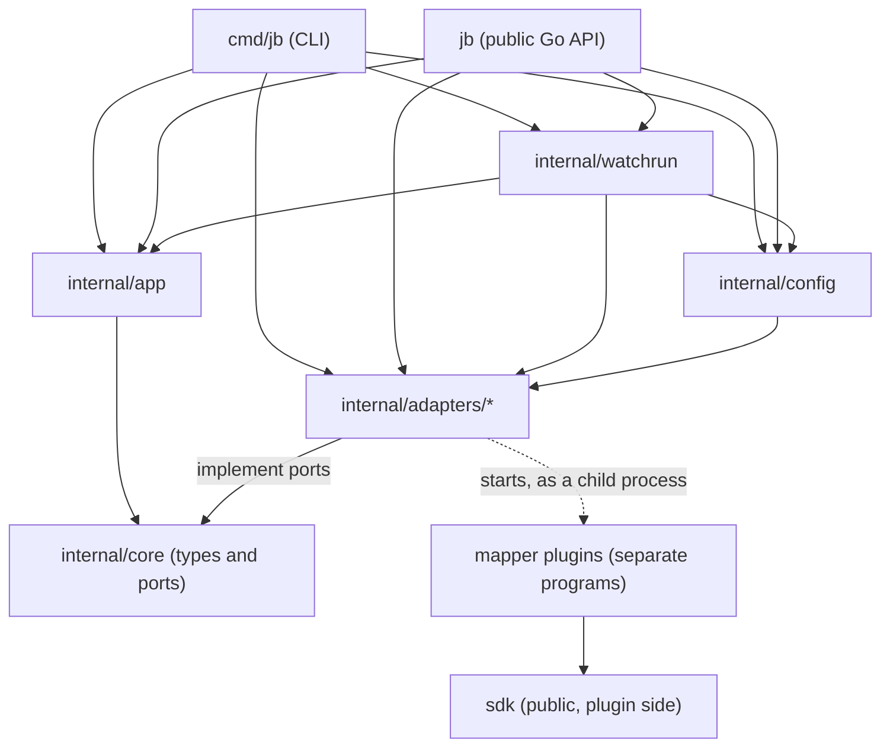

# Architecture

[Back to the README](../README.md)

`jb` is a hexagonal layout: a small core of types and ports, one use case, and adapters that implement the ports. Only the composition roots know every adapter.

```
cmd/jb  ──►  internal/config ──► internal/adapters/*   (kibana, duckdb, detectors/*)
  │                  │                      │
  │                  └──────────────────────┤ implement
  ▼                                         ▼
internal/app  ───────────────────────►  internal/core   (types and ports, standard library only)
```

Since v0.1.0 there are two public entry points besides the CLI. Both are composition roots, like `cmd/jb`, and share the wiring in `internal/watchrun` and `internal/config`:



`sdk` is what a plugin author imports. It uses the standard library only and none of the host code. `jb` and `sdk` are the only packages outside `internal/` that code in other modules may import; both are v0 and may change between minor versions.

| Package | Role | May import |
|---|---|---|
| `internal/core` | Domain types and the ports. | Standard library only. |
| `internal/app` | Use cases (`Hunt`, `Watch`). | `core`. No adapter, config, cobra, DuckDB, YAML, `net/http` or `database/sql`. |
| `internal/adapters/*` | Implementations of the ports. | `core`. Never each other, never `app`. |
| `internal/config` | Reads YAML, builds adapters, reads credentials from the environment. | `core` and adapters. Not `app`, not cobra. |
| `internal/adapters/runlock` | The single-instance lock of `jb watch`. | The standard library only: no internal package, no network, no process, no log. |
| `internal/watchrun` | Builds the ports of `app.Watch` and `app.Hunt` from a loaded case config (file names, lock, store open/close per operation, alert sinks). Shared by `cmd/jb` and `jb`. | `core`, `app`, `config` and adapters. |
| `jb` (repo root) | The public Go API: one function per command (`Hunt`, `Activity`, `Watch`, `Doctor`, `DB*`, `Estate*`, `Intel`, `DashboardHandler` and the rest; README has the table). | Like `cmd/jb`: it wires config, watchrun, app and the store. |
| `sdk` | The plugin side of the mapper protocol, public. | Standard library only. |
| `cmd/jb` | The cobra CLI. Wires config, the store, the watch adapters, the web dashboard and `app.Hunt` / `app.Watch`. | Everything. |

## Ports

Defined in `internal/core/core.go`:

| Port | Shape | Purpose |
|---|---|---|
| `Source` | `Name()`, `Fetch(ctx, Window) iter.Seq2[Event, error]` | Streams events for a half-open window `[From, To)`. Stops when `ctx` ends. |
| `Detector` | `Name()`, `Detect(ctx, cur, prev EventReader, w Window) ([]Finding, error)` | Compares the current window with the preceding one. Returns `ErrNoRecords` when the current window holds nothing to judge, unless the detector was configured with `empty_is_quiet` (see docs/CONFIG.md), which `internal/config` only allows when every source it reads proves its index alive. |
| `EventReader` | `Events(ctx, Window) iter.Seq2[Event, error]` | Read side of the evidence store. |
| `Sink` | `SaveEvents(ctx, run, events)`, `SaveFindings(ctx, run, findings)` | Persists a run. Saving the same run twice replaces it. |
| `RunPruner` | `PruneRuns(ctx, prefix, before) (PruneResult, error)` | Deletes the events, findings and run records of old hunts whose id is exactly `prefix` + a UTC stamp, in one transaction, never the newest such hunt (per prefix, so one watcher's retention cannot reach another's). Implemented by the DuckDB store; used by `jb watch` retention. |
| `StoreUsageReader` | `StoreUsage(ctx) (StoreUsage, error)` | Fixed-query measurement of the store per run kind and per source label (`jb db usage`). Run kinds are derived in `core` from the whole run-id shape (`ClassifyRun`). Reads only. |
| `RunEventPruner` | `PruneRunEvents(ctx, EventPruneRequest) (EventPruneResult, error)` | Deletes the events of old runs of named kinds (`jb db prune`): the newest N of each kind kept, findings and run records kept (stamped `pruned_at`) unless asked, the plan counted and checked against the engine's row counts in one transaction. Never watch runs, never reputation. A dry run works on a read-only handle. |
| `StoreCompactor` | `Compact(ctx, CompactRequest) (CompactResult, error)` | Writes a verified compacted copy of the open store to a new file (`jb db compact`); never replaces the original. |
| `ParseCounter` | `Unparsable() int` | Optional on a `Source`: how many documents of its last fetch it could not parse. `Hunt` copies it into `SourceResult.Unparsable`. |
| `LivenessReporter` | `Liveness() Liveness` | Optional on a `Source`: whether its last fetch matched nothing through a filter and then counted the same window without it and found documents. `Hunt` copies it into `SourceResult.IndexAlive` and `IndexDocs`, and a sink's refusal of an empty save is then an answer (`no match; index alive`), not `no_records`. |
| `DocScoped` | `DocScope() string` | Optional on a `Source`: the store whose document identities its events carry in `Event.DocKey` (for Kibana, the cluster URL; the key is the concrete index and `_id`). When two or more sources of one run share a scope, `Hunt` keeps the first copy of each `DocKey` and counts the rest in `SourceResult.Duplicates`, so overlapping filters on one index do not double count. `DocKey` is never stored. |
| `ActivityReporter` | `Activity(ctx, cur, prev, w) (ActivityReport, error)` | Optional on a `Detector`: per actor or action, the genuine events in the window and before it, the last genuine event, and what was set aside as noise or infrastructure. Implemented by the fingerprint and behaviour detectors over the same scan as `Detect`. Used by `app.Activity` and `jb activity`. |
| `FieldEventFinder`, `ActorHistorian` | `EventsByField(ctx, field, value)`, `History(ctx, finder)` | The store's events with one field equal to a value, newest first (a fixed parameterised query in `duckdb`), and the fingerprint detector's use of it to say when each actor user agent last matched. Used by `app.ActorStatus` and `jb actor status`. |
| `AlertSink` | `Deliver(ctx, Alert) error` | One alert to a human. Returns nil only when delivered. Implemented by `alertlog` (stdout plus an append-only file) and `webhook` (a POST to a chat webhook). `core.FanOut` combines them: a required sink (the log) first, then optional ones. If the required sink fails the alert is undelivered and no optional sink is tried; if an optional sink fails the alert still counts as delivered, and the error comes back as `*core.OptionalDeliveryError`, which fails the cycle. |
| `WatchStateStore` | `Load(ctx)`, `Save(ctx, WatchState)` | What a watch remembers between cycles and restarts. Implemented by `watchstate` (one JSON file). |
| `Feed` | `Name()`, `Lookup(ctx, indicators) ([]Reputation, error)` | External reputation lookup, implemented by `internal/adapters/greynoise` and `internal/adapters/sansisc` (HTTP) and `internal/adapters/dnsbl` (a DNS question through an injected `Resolver` port that `*net.Resolver` satisfies; no HTTP) and used by `jb intel` (`app.Intel`). Returns the answers it has plus a joined `*LookupError` per indicator it could not answer; a failure is never an empty `Reputation`. `app.Intel` asks every feed about every indicator: each pair is its own answer, a feed failing makes the run incomplete and keeps the others', a row whose `Source` is not the feed's `Name()` is refused, and two feeds with the same name are refused. A snapshot is context, not attribution, and never reaches a detector. |
| `PTRResolver` | `LookupPTR(ctx, ip) (PTRAnswer, error)` | Reverse-DNS lookup, implemented by `internal/adapters/dnsptr` over an injected `net.Resolver` and used by `jb estate` (`app.CollectEstate`). NXDOMAIN is `ErrNotFound`, an answer; a timeout or SERVFAIL is `ErrLookupFailed`, never data. |
| `RDAPRegistry` | `LookupIP(ctx, ip) (RDAPNetwork, error)` | Registry lookup, implemented by `internal/adapters/rdap` and used by `jb estate`. A real 404 is `ErrNotFound`, a 429 `ErrRateLimited`, anything else that is not a usable 200 `ErrLookupFailed`. The adapter's dialer refuses a connection to the address it is asked about. |
| `BGPSource` | `LookupASN(ctx, asn) (BGPAnnouncement, error)`, `LookupIP(ctx, ip) (BGPOrigin, error)` | Prefixes an AS announces, or the route and origin AS of an address, implemented by `internal/adapters/bgp` (RIPEstat-style API, URL from config) and used by `jb estate asn` (`app.CollectASN`). A third-party service. Nothing announced is `ErrNotFound`, a 429 `ErrRateLimited`, anything else that is not a usable 200 `ErrLookupFailed`; a prefix list cut at the cap sets `Truncated`. The dialer refuses a connection to the address it is asked about. |
| `CTSource` | `LookupSubdomains(ctx, domain) (CTAnswer, error)` | Names on publicly logged certificates for a domain, implemented by `internal/adapters/crtsh` (crt.sh-style JSON) and used by `jb estate ct` (`app.CollectCT`). A third-party service. Names are candidates; wildcards and names outside the domain are counted, not returned; more names than the cap sets `Truncated`. The adapter refuses to connect to the domain or any name under it, in the URL check, the redirect check and the dialer. |
| `DNSForward` | `Lookup(ctx, name, DNSType) (DNSAnswer, error)` | Forward records (A, AAAA, CNAME, MX, NS, SPF from TXT) implemented by `internal/adapters/dnsfwd` over an injected `net.Resolver` and used by `jb estate dns` (`app.CollectDNS`). NXDOMAIN or no record is `ErrNotFound`; a timeout or SERVFAIL is `ErrLookupFailed`. Other TXT values are never returned. |

| `DashboardStore` | `Stats`, `Runs`, `Run`, `EventSummary`, `RecentEvents`, `RunFindings`, `LatestFindings`, `LatestReputation`, `Close` (all bounded by a limit and a context) | The read side of the evidence store as `jb serve` needs it. Implemented by `duckdb.Dashboard`, which can only be built on a handle opened with `access_mode=READ_ONLY`. A run group with no stored events reports `Incomplete()`. |
| `LogTailer`, `WatchStatePeeker` | `Tail(ctx, n)`, `Peek(ctx)` | The end of `watch.log` (bounded read) and the watch state read without the writer's move-aside-on-corruption. Implemented by `alertlog.Tailer` and `watchstate.Store.Peek`. `core.ErrAbsent` means the file is not there, which a panel says in words. |
| `EstateReader` | `Estates(ctx) ([]EstateGraph, error)` | The case's estate files as view types. Implemented in `cmd/jb` over `casefile`, so the web adapter never imports the case format. |

Sentinel errors: `ErrAbsent` (the thing asked for is not there: an answer, never a failure), `ErrFeedFailed`, `ErrRateLimited` and `ErrBudgetExceeded` (reasons a feed lookup got no answer), `ErrTruncated` (an estate answer cut at a cap; the run is incomplete), `ErrNoRecords` (zero records parsed, never a clean negative) and `ErrSourceUnavailable` (the backend could not be reached or refused the query).

## What a hunt does

`app.Hunt` (`internal/app/hunt.go`):

1. Computes the baseline as `w.Previous()` and asks every source for the span covering both windows.
2. Streams each source into the sink under the run id `<run>/<source name>`. Sources run concurrently (default bound 4); sink writes are serialised because DuckDB has one writer.
3. Runs every detector concurrently over the *stored* evidence, not over the source. A finding therefore traces to rows in the store. Each detector gets readers clamped to the current and baseline windows, so it cannot read the wrong one by accident. A detector named in `Deps.Scopes` (the config's `sources:`) gets those readers narrowed once more to the events stored under its sources, in both windows; `Hunt` stamps every event with the name of the source that returned it so that the stored `source` column is that name, and `Deps.readersFor` is the single place the narrowing is applied, for `Hunt` and `Activity` alike. `Hunt` refuses a scope that is empty, names a source that is not among the sources, or names no detector. The detectors stay pure: they see an `EventReader` and cannot tell it is scoped.
4. Deduplicates findings by `Tag` (most severe wins) and saves them under the run id.

A source or detector failing is recorded in the result and does not stop the others. The result status is one of `ok`, `no_records`, `unavailable`, `canceled`, `error`; anything but `ok` makes the hunt incomplete. A detector that returns findings and an error (a detector with independent rules, one of which could not be judged) has those findings kept, counted, stored and alerted like any other; its status stays `error` or `no_records`, so the hunt is still incomplete and never reads as clean ([RFC 0012](rfcs/0012-partial-findings.md)). The contract is on `core.Detector`: the findings returned beside an error must rest only on evidence the detector read.

## What an activity check does

`app.Activity` (`internal/app/activity.go`) runs `Hunt` with detectors that implement `ActivityReporter`, then asks each for its report over the stored evidence and assesses the result. `ACTIVE` needs one active subject. `QUIET` needs no active subject and no reason against it: a source or detector that did not finish, a source at or above 20% unparsable, a detector that could not judge 20% or more of what it read, a detector that stopped at a cap, no source or no detector. Any such reason with nothing active is `INCOMPLETE`. A detector that did not finish but returned a finding makes the check `ACTIVE` and incomplete at once. `jb actor status` is `app.ActorStatus` over the read-only store.

## What a watch does

`app.Watch` (`internal/app/watch.go`) repeats a hunt every `--every` and tells a human only what is new. It adds no detector and no source; it reaches the hunt through a function the command supplies (`WatchDeps.Hunt`), so the use case still sees ports only. One cycle (`WatchCycle`):

1. Loads the state (`WatchStateStore`). A missing file is a cold start; a corrupt one is kept as `<file>.corrupt`, reported as an alert, and the cycle runs with no memory. Not watching is never the safe choice.
2. Runs the hunt over `[now - window, now)` under the run id `watch-<UTC time>`. A source or detector that did not finish becomes an alert of its own (tag `watch-incomplete`); a hunt that errored becomes `watch-cycle-error`. Neither is ever read as quiet.
3. Surfaces findings. A tag alerted within `--ttl` at the same or a higher severity is held back; a tag is remembered only after its alert was delivered, so an undelivered alert is offered again. Delivered means the required sink (the log) has it; a configured webhook that failed does not undo that, but it makes the cycle `FAILED` (see [CONFIG.md](CONFIG.md#alert-delivery)). Findings are never held back for any other reason.
4. Holds back a repeated outage alert: an identical failure (same component, same text once the run id and timestamps are removed) alerts again at most every `--repeat`. A changed text alerts at once. A component that finishes after being reported down produces a `watch-recovered` alert at once. The held-back alert is counted on the cycle line ("still down"), and the cycle is still `INCOMPLETE`, so `--once` still exits 1.
5. Saves the state, then prunes: `RunPruner.PruneRuns("watch-", now - keep)`, or `"watch-NAME-"` for a named watcher. A prune that fails raises a `watch-prune` alert and fails the cycle.
6. Delivers the cycle line: `CYCLE QUIET`, `CYCLE FINDINGS`, `CYCLE INCOMPLETE` or `CYCLE FAILED`, so a silent watcher is distinguishable from a broken one. It also carries the held-back, recovered, unparsable and pruned counts.

The cycle's verdict is an `app.CycleStatus`; `Healthy()` is true only for quiet and findings. `Watch` stops without an error when its context ends (SIGINT, SIGTERM), before delivering anything for a cycle that was cut short.

Named watchers (`jb watch --name`): `WatchDeps.Name` stamps `Alert.Watcher` on every alert (the log renders `[w:NAME]`), `WatchRunPrefixFor(name)` gives the run-id prefix (`watch` or `watch-NAME`, always under the reserved `watch-`), and `cmd/jb` names the state, log and lock files after it. `Watch` refuses a run prefix that is not the name's own, so retention (which matches `prefix + stamp` exactly, never a bare prefix) cannot miss a watcher's runs or reach another's. `WatchDeps.Disabled` carries what the config switched off into every cycle line. The single-instance lock is the adapter `internal/adapters/runlock` (flock plus the holder's PID, standard library only, with its own archtest rule), taken by `cmd/jb` before anything is built.

Adapters: `internal/adapters/alertlog` (stdout and `<evidence>/watch.log`, one escaped line per alert, no network) and `internal/adapters/watchstate` (`<evidence>/watch-state.json`, written to a temp file, synced and renamed, so a crash leaves the old state or the new one). Both have archtest rules. `internal/adapters/webhook` is another adapter allowed to import `net/http` as a client (with `kibana`, `greynoise`, `sansisc`, `rdap`, `bgp` and `crtsh`; `internal/adapters/web` imports it too, but only to serve, see [The dashboard](#the-dashboard)); it takes the URL as a value from `internal/config`, reads no file or environment variable and starts no process.

### Disabled sources and detectors

`enabled: false` is resolved in `internal/config` and nowhere else: `Build` does not construct a disabled source or detector, so the use cases never see one. What they do see is the list of names (`app.Deps.Disabled`, from `config.Runtime.DisabledSources` and `DisabledDetectors`), which `Hunt` copies into `Result.Disabled` and `Activity` into `ActivityResult.Disabled`, and which the commands print (`app.DisabledNote`). A disabled component has no row in `Result.Sources` or `Detectors`, so it has no status that could be read as ok. The load-time rules (a scope naming a disabled source, nothing to run, `empty_is_quiet` over enabled sources only, a non-boolean value) are in `config.Parse`; see [CONFIG.md](CONFIG.md#switching-a-source-off-enabled).

### Watch runs and retention

A hunt stores its window and the baseline before it, so a watch writes that much under a new run id every cycle. `--keep` (default 48h, at least twice `--window`) bounds the growth. `Store.PruneRuns` groups run ids by the part before the first `/` (the findings run `watch-X` and the event runs `watch-X/<source>`), treats a group as stale when its newest record is older than the cutoff, and removes events, findings and run records of all stale groups in one transaction. It matches the prefix with `starts_with`, so `hunt-*` runs and the reputation table are never reachable, and it never removes the newest group. The `watch-` prefix is therefore reserved: no other command should name a run that way. Read-only handles still refuse every write, `PruneRuns` included.

## What an estate drift check does

`jb estate facts import FILE` is not a use case over a port: it reads one local file through `casefile` and never touches the network (`jb.EstateFactsImport`). `jb estate refresh|diff|promote` compare the operator's own estate with itself over time. It is three use cases and no new port: the collectors are the existing `PTRResolver`, `RDAPRegistry`, `BGPSource`, `CTSource` and `DNSForward`, so the passive-only allowlist and the per-service switches apply unchanged.

- `app.EstateTargets` reads the questions an estate file records back out of its claims, `app.RefreshEstate` runs the collectors for them and returns an `EstateSnapshot` (a `casefile` type: data, yaml only), and `casefile.WriteEstateSnapshot` writes it with a temporary file and a hard link, so an existing snapshot is never replaced. Failures, skipped services and merge conflicts go into the snapshot; `complete` is false if there is any failure.
- `app.DiffEstates` groups claims by `(source, method)`, the exact question. Only a question present on both sides is compared; the rest is returned as `NotComparable`. It is a pure function of two loaded estates, deterministic (everything is sorted), and refuses an incomplete snapshot. `app.DriftFindings` turns edge changes into `core.Finding`s; `app.DeliverDrift` applies the watch loop's TTL rule against a `core.WatchStateStore` and a `core.AlertSink`.
- It is a separate command, not a watch check. The watch loop is a hunt over a local store, run every few minutes; refresh is network I/O to third parties and drift moves in hours or days. Wiring it into `app.Watch` would put a slow, chatty step in every cycle and would need `WatchDeps` to learn about the case format. The seam is the finding and the alert: `diff --alert` produces `core.Finding`s with stable tags and sends them through the same sinks and the same dedupe rule, so a scheduled `refresh && diff --alert` looks like watch to whoever reads the alert log. Active estate checks (scans, probes, GitHub) are deliberately absent; see `docs/POLICY.md`.

## The dashboard

`jb serve` (`cmd/jb/serve.go`) wires `internal/adapters/web`, a **serving** adapter: it listens (the command hands it a `net.Listener`) and never calls out. It depends on `core`, `internal/estategraph`, the standard library (`net/http`, `embed`) and the templ runtime, and reads everything through the ports above, so it has no SQL, no file, no environment and no process access. Pages are templ components (`*.templ`, generated `*_templ.go` committed); `primitives.templ` holds the small design-system components (card, alert, badge, sheet) whose look comes from the tokens in `assets/input.css`; htmx loads fragments (a record into the sheet, a filtered findings table, the watch panel) with GET requests only, answering with the fragment when the request carries `HX-Request` and the whole page otherwise.

- **Read-only by the engine.** `duckdb.OpenDashboard` opens with `access_mode=READ_ONLY` and the `Dashboard` type has no writable constructor. Every query is fixed text with bound parameters; the one identifier that comes from configuration (the event field names behind `--path-field` and friends) is validated against `[A-Za-z0-9_.@-]{1,64}` and bound as a JSON path. There is no endpoint that accepts SQL, and a test shows a write through the handle failing. The handle is opened per request and closed with it, so `jb watch` (one writer) is never locked out between requests; if a writer holds the file at that moment the page shows an error banner, not an empty table.
- **Untrusted text.** Stored strings reach the page only through templ's escaping (every `{ value }` is escaped for where it lands), after control characters are dropped and the length is capped (300 characters). `TestWebAdapterHasNoRawHTMLOrScriptEscapeHatch` fails the build on `templ.Raw`, `SafeURL`, the script helpers and `template.HTML`. Links are built from a fixed path and a percent-encoded value, never taken from a stored string. The one JSON document (`/estate/graph.json`) is encoded with `<`, `>` and `&` escaped, and the graph script sets every label as text. The CSP is `default-src 'none'; script-src 'self'; connect-src 'self'; style-src 'self'; img-src 'self'; base-uri 'none'; form-action 'self'; frame-ancestors 'none'`: script only from this origin (two vendored libraries (htmx and d3) and two small files of ours (`estate.js` and `sheet.js`), each loaded with a plain `<script src defer>`; a test fails on any inline script, handler attribute or inline style), no eval, no other origin. htmx is configured through a `<meta name="htmx-config">` to refuse eval, script tags in a swapped fragment, injected styles, history snapshots (a page of log text must not be copied into browser storage) and cross-origin requests. Also `X-Content-Type-Options: nosniff`, `Referrer-Policy: no-referrer`, `Cache-Control: no-store`; no CORS header is ever set; only GET and HEAD are answered.
- **Binding.** `web.CheckAddr` refuses a non-loopback address unless `--allow-remote`, and `":8090"` and `0.0.0.0` count as non-loopback. On loopback the `Host` header must be a loopback name (421 otherwise), which stops DNS rebinding from a page in the operator's browser. There is no authentication.
- **Bounded.** Row limits on every query (runs 100, top lists 15, raw events 50, findings 200, reputation 200), a 20 s request budget (`http.TimeoutHandler`, which also cancels the query context), read-header 5 s, read 15 s, 16 KiB of headers.
- **Never a clean-looking empty.** A panel with nothing says why (`no runs yet`, `estate dir absent or empty`, `no alert log`), a failed query is a red banner, a run with no stored events is `INCOMPLETE`, and a log with no `CYCLE` line says it cannot tell whether a watch is running. The store keeps no per-source completion, so the dashboard cannot show which source failed in a hunt; the cycle line in `watch.log` is the record of that.
- **net/http is serving-only here.** `internal/archtest` allows the web package to import `net/http`, but `TestWebAdapterIsServingOnly` parses its non-test files and fails on any `net/http` or `net` identifier outside an allowlist (`Handler`, `HandlerFunc`, `ServeMux`, `ResponseWriter`, `Request`, `Header`, `Server`, `TimeoutHandler`, `Status*`, `Method*`, `net.Listener`, `net.SplitHostPort`, `net.JoinHostPort`). `http.Get`, `http.Client`, `http.NewRequest`, `http.Transport`, `net.Dial` and the rest are therefore build failures. `TestServingScannerFlagsClientSymbols` checks the scanner itself finds them. The web package may not import the app, config, case format, other adapters, `database/sql`, `os`, `os/exec`, `net/url` or `log`.

## What a doctor does

`app.Doctor` (`internal/app/doctor.go`) runs the checks behind `jb doctor` and returns a `DoctorReport`; it passes only if no check has status `fail`. It sees the world through small ports it defines: `DoctorConfigs` (strict load, returning services as names and flags), `DoctorCases` (the `case check` results), `DoctorEnv` (`IsSet(name) bool`: the only thing it can learn about a variable, so no value or length can reach a report), `DoctorStores` (what the filesystem and the engine say about the store path) and, only with `--online`, `DoctorReach` (resolve a host:port, make one TCP connect). `cmd/jb/doctor.go` implements them over `internal/config`, `casefile` and the DuckDB adapter, and is the only place that does I/O for it. The use case imports no adapter, config, `net`, `net/http` or `os`. It also lists the plugin allowlist through `DoctorPlugins` (names, paths, pin state and mode checks, launching nothing). Doctor has no tool inventory: the only external programs jb starts are the allowlisted mapper plugins and `git`, for the evidence guard.

## Decisions about other plugin specifications

How `jb` relates to the maintainer's draft plugin specifications (independent, own mapper protocol, built-in dashboard, no action role) is one ADR: [adr/0001-relationship-to-other-plugin-specifications.md](adr/0001-relationship-to-other-plugin-specifications.md).

## Mapper plugins

A `kibana` source can name `mapper: plugin:<name>`. `internal/config` resolves the name in the operator's allowlist, builds one `internal/adapters/plugin.Host` for that source and sets it as the source's `core.BatchMapper`. The source maps each page of new documents in one `MapBatch` call; the host speaks the plugin protocol to a long-lived child process and returns exactly one `core.MapResult` per document, or an error that fails the source. The source cannot import the host (adapters never import each other), which is why the port, `core.BatchMapper`, is in `core`. `config.Runtime.Close` ends the child; the commands defer it. `docs/PLUGINS.md` has the protocol, the limits and the trust model.

`internal/adapters/plugin` is the one package that may import `os/exec` for plugins (`internal/casefile` imports it for the git guard); `TestOSExecIsConfined` enforces both. The example plugins under `plugins/` are separate programs that import the standard library and `sdk` only, and nothing in `jb` imports them (`TestPluginsAreStdlibOnlyAndInert`, `TestNothingImportsThePlugins`).

## Evidence store

`internal/adapters/duckdb` implements `Sink` and `EventReader`. Schema changes are numbered, embedded SQL migrations, additive and never edited once released. Writers apply missing migrations; a handle refuses a file whose schema is ahead of the build. Read-only is DuckDB's `access_mode=READ_ONLY`, so the engine refuses writes, not a prefix check on SQL.

Events across overlapping runs are de-duplicated on read. Two stored rows are the same event when they agree on `(source, ts, kind, doc_sha256)` and on their occurrence number within their own run. Two identical lines inside one fetch are real events and both survive. If runs disagree on how many copies exist, the larger count wins; of rows with the same identity the latest run is returned. `ts` is stored at microsecond precision. The exact rule is the doc comment on `Store.Events`.

The source **label** is part of that identity, deliberately: dropping it would break `sources:` scoping on stored history. The consequence is that one set of documents stored under two labels (a default `kibana:<index>` and a later explicit `name:`) is read as two. The duckdb adapter implements two ports for this, both in `internal/core/sourcelabel.go`: `SourceOverlapReader` (`jb hunt`, `activity`, `watch` and `doctor` use it to print a warning, never changing a verdict) and `SourceRelabeler` (`jb db rename-source`, one transaction on `events.source`, dry run on a read-only handle). See [CONFIG.md](CONFIG.md#source-labels-and-double-counting).

Nothing prunes the store except `jb watch --keep` (its own `watch-` runs, per watcher). One-off runs (`hunt`, `hunt-until`, `activity`, `search`) stay until `jb db prune` removes their events, and because the same documents fetched by overlapping runs are stored once per run, repeated backfills grow the file several times faster than the distinct document count. The duckdb adapter implements `StoreUsageReader`, `RunEventPruner` and `StoreCompactor` for this (`internal/core/maintenance.go`; schema v2 adds the nullable `runs.pruned_at`). DuckDB gives no space back after a delete, so shrinking the file means writing a compacted copy (`jb db compact`) that the operator swaps in. See [CONFIG.md](CONFIG.md#store-maintenance).

Opening the file waits, within a bounded budget, for the one cross-process lock error (`openRetry` in `internal/adapters/duckdb/lock.go`): one read-write process or many read-only ones, never both, and `jb watch` holds the write side for a few seconds per cycle. Only that error is retried; see [CONFIG.md](CONFIG.md#locking-one-writer-or-many-readers).

`internal/casefile` loads a case directory (the data of one investigation, kept outside this repository). It is standard library plus YAML and is used by `jb case check`, `jb hunt --case` and `jb watch`; see [CASE-SPEC.md](CASE-SPEC.md).

## Command wiring

`jb hunt` and `jb watch` share one sequence in `cmd/jb/opencase.go`: `openCase` loads the config, places the store under the case's evidence directory and hands the case to the config when there is one, then builds the adapters (the only step that reads the environment). The command differs only in what it does with the result: hunt runs once and prints a table or JSON; watch wraps the same hunt in `app.Watch`, opening the store for each hunt and closing it again so `jb db` works between cycles.

## The dependency rules are tests

`internal/archtest` runs `go list` on each package and fails when it imports something its rule forbids. Each rule carries a `why` that appears in the failure message. It checks direct imports only.

Run it with `-count=1`:

```sh
go test -count=1 ./internal/archtest
```

Go's test cache keys on the files a test reads, and it cannot see what the `go list` subprocess reads. Edit an import in `internal/app` and a cached run still reports `(cached)` and passes. Without `-count=1` the rule can be broken and the test green. CI uses `go test -race -count=1 ./...`.

A new adapter package needs its own rule in `archtest_test.go`; nothing applies a default to a package that has no entry. Three generic tests back that up: a package that carries the `core.Feed` assertion without a rule fails (`TestEveryFeedAdapterHasADependencyRule`), no feed adapter may be imported by a detector, the use cases or the store (`TestNoFeedAdapterIsImportedByADetectorTheHuntOrTheStore`), and no adapter may import another (`TestAdaptersNeverImportEachOther`). `net/http` is allowed in the remote adapters only; `dnsbl`, `dnsptr` and `dnsfwd` have none. A rule is not finished until you have seen it fail (add the forbidden import, run, watch it go red, remove it).

## Adding an adapter

A new source or detector is one package under `internal/adapters/`, one registration file in `internal/config/`, one line in `internal/config/registry.go` and one rule in archtest. See [WRITING-A-SOURCE.md](WRITING-A-SOURCE.md) and [WRITING-A-DETECTOR.md](WRITING-A-DETECTOR.md).
